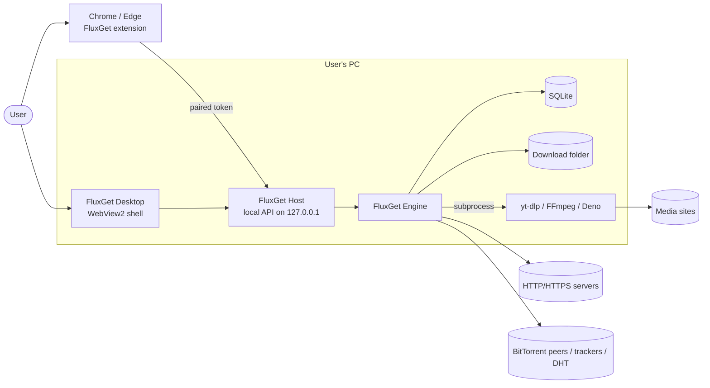
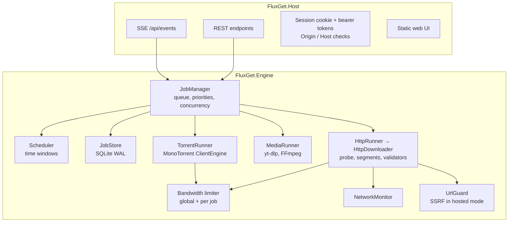
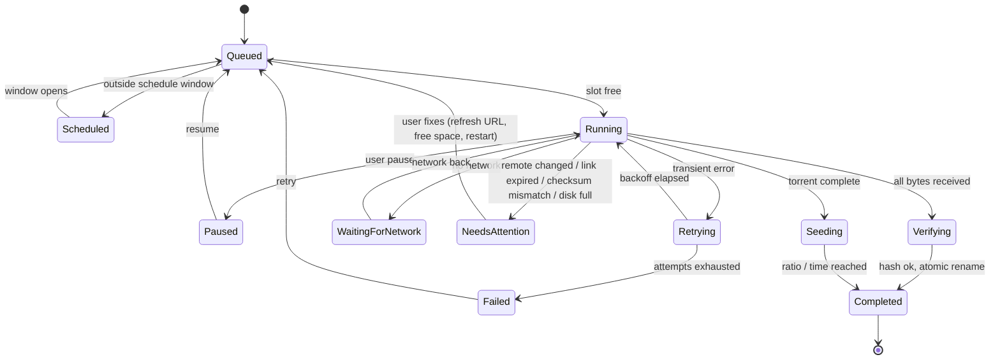
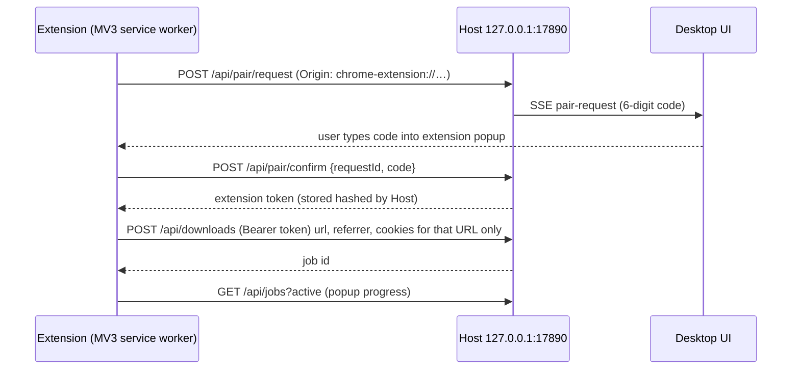
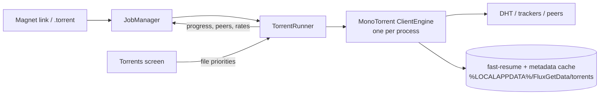
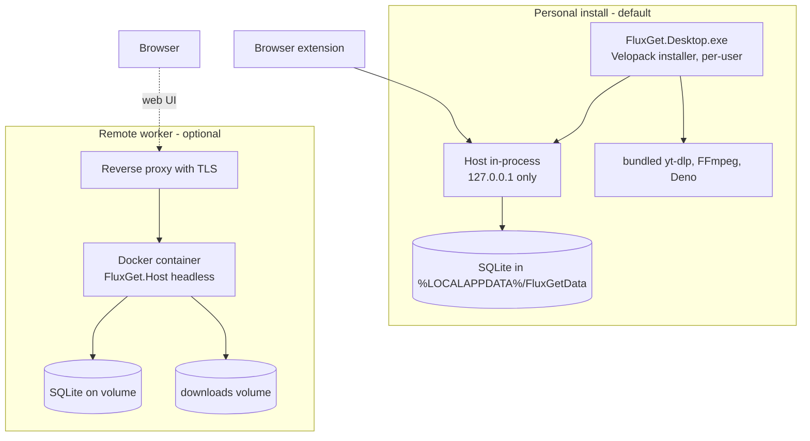
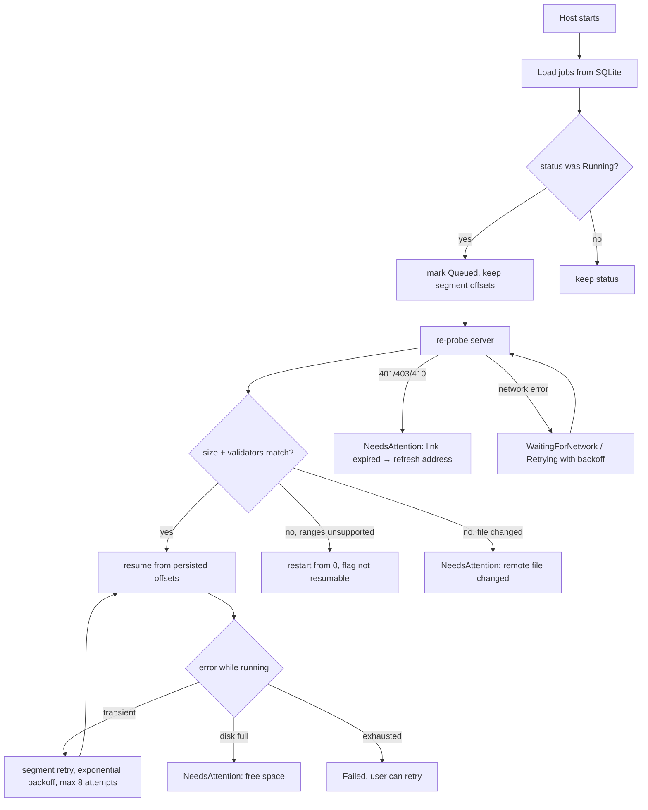

# FluxGet Architecture

FluxGet is a personal download manager: segmented HTTP/HTTPS downloads, media extraction (yt-dlp + FFmpeg), BitTorrent (MonoTorrent), a browser extension, and an optional headless/remote mode. It is a modular monolith written in C# / .NET 10 with a React UI.

## Modules

| Project | Responsibility |
| --- | --- |
| `src/FluxGet.Engine` | Everything that moves bytes. Job store (SQLite), queue + scheduler, segmented HTTP downloader, bandwidth limiter, media jobs (yt-dlp/FFmpeg subprocesses), torrent jobs (MonoTorrent). No ASP.NET dependency. |
| `src/FluxGet.Host` | ASP.NET Core local API: REST + Server-Sent Events, session/pairing auth, serves the built web UI. Runs inside the desktop app or headless (`FluxGet.Host.exe`, Docker). |
| `src/FluxGet.Desktop` | Windows shell: WinForms window hosting WebView2, tray icon, single instance, `fluxget://` protocol, Velopack install/update. Starts the Host in-process. |
| `web/` | React + TypeScript + Vite + Tailwind UI. Same build is used by the desktop window and by a regular browser (web interface). |
| `extension/` | Manifest V3 extension for Chrome/Edge (Firefox later). Sends jobs to the Host over `127.0.0.1` with a paired token. |
| `tests/` | xUnit engine tests against a controllable in-process HTTP server (`FluxGet.Testing`). |
| `bench/` | Throughput / segment-count / recovery benchmarks. |

Engine boundaries that matter:

- `JobManager` owns job lifecycle and the queue. It knows nothing about HTTP, torrents or yt-dlp — it starts an `IJobRunner` for the job kind (`HttpRunner`, `MediaRunner`, `TorrentRunner`).
- `HttpDownloader` is the only code that issues range requests. Media extraction never goes through it: yt-dlp handles its own protocols (DASH, HLS, signatures), FluxGet just supervises the process.
- `JobStore` is the only code that talks to SQLite.

## System context

## Component architecture

## Download lifecycle

`Running` is shown in the UI as Downloading, Converting or Probing depending on the phase.

## Segmented HTTP download

```mermaid
sequenceDiagram
  participant R as HttpRunner
  participant S as Server
  participant F as .fgpart file
  participant DB as SQLite
  R->>S: GET Range: bytes=0-0
  S-->>R: 206, Content-Range bytes 0-0/N, ETag, Last-Modified
  Note over R: 206 → ranges supported<br/>200 → single connection
  R->>F: create & SetLength(N)
  R->>DB: save validators + segment plan
  par each segment (default 6)
    R->>S: GET Range: bytes=a-b, If-Range: ETag
    S-->>R: 206 Content-Range a-b/N
    R->>F: positional writes (RandomAccess)
  end
  loop every 2 s
    R->>R: snapshot segment offsets
    R->>F: flush to disk
    R->>DB: persist snapshot (never ahead of disk)
  end
  Note over R: finished worker steals half of the<br/>largest remaining segment (≥ 2 MiB)
  R->>F: verify checksum (optional)
  R->>F: atomic rename to final name
```

Rules the downloader enforces:

- A 200 reply to a ranged request, a `Content-Range` that does not start where we asked, a changed total length, or a changed `ETag`/`Last-Modified` aborts that worker. On resume this means the remote file changed: the job goes to *NeedsAttention* instead of mixing bytes from two versions.
- Servers without range support get exactly one connection, and resume restarts from zero (shown to the user as "not resumable").
- Weak ETags (`W/`) are not used for `If-Range`; `Last-Modified` is used instead when available.
- 401/403/410 on resume = likely expired link → *NeedsAttention* with "Refresh address", which swaps the URL and keeps partial data only if size and validators still match.

## Browser extension communication

Why localhost + pairing rather than native messaging: no registry manifest per browser, the same API serves the web UI and remote mode, and Firefox works with the same code. Websites cannot use it: requests with an `http(s)` Origin are rejected, the Host header must be `127.0.0.1`/`localhost` (DNS-rebinding defence), and every non-pairing call needs a token. The desktop UI authenticates with an HttpOnly `SameSite=Strict` cookie that the shell injects into WebView2.

## Torrent integration

The engine-wide bandwidth limits are mapped onto MonoTorrent's own download/upload rate settings; seeding stops at a configurable ratio or time.

## Deployment

Hosted multi-user (PostgreSQL, per-user quotas) is intentionally out of the first release — see DECISIONS.md D-008.

## Failure and recovery

Persisted offsets are always written *after* the file data they describe has been flushed, so a crash can lose at most the last checkpoint interval of progress, never correctness.

## Data model (SQLite)

- `jobs` — id, kind (http/media/torrent), url, status, file name, directory, total/received bytes, validators (etag, last_modified), resumable flag, priority, per-job speed limit, checksum, schedule flag, error, options JSON, timestamps. Indexed on (status, priority, created_at).
- `segments` — job_id, idx, start, end, received.
- `settings` — key/value JSON.
- `tokens` — hashed extension tokens.

Request headers supplied by the extension (cookies, referrer) are held in memory only and never written to the database or logs.
